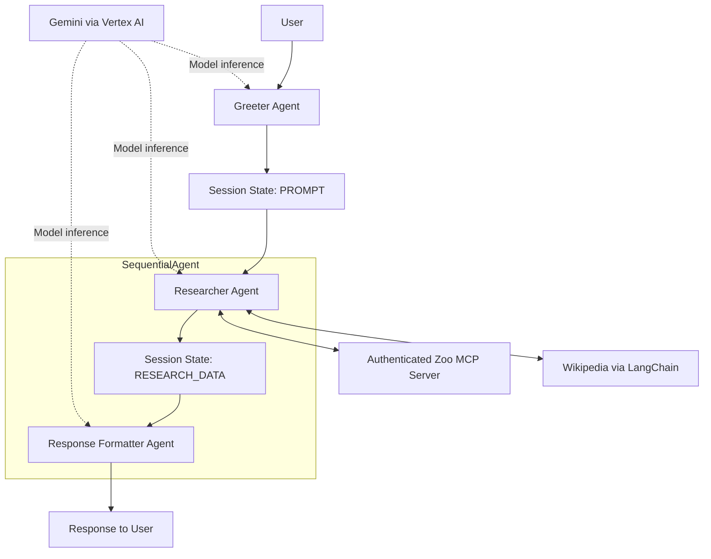

# Multi-Agent Zoo Tour Guide

Hands-on AI engineering lab using Google ADK, Python, Gemini via Vertex AI, and an authenticated Zoo MCP service. The workflow was deployed to Google Cloud Run; some model requests encountered Vertex AI 429 quota errors.

## Workflow



Three specialized agents use handoffs and session state. The Researcher combines zoo data and general knowledge; the Formatter presents the result.

## Files and configuration

- `agent.py`: ADK entry point exporting `root_agent`.
- `__init__.py`: exposes the agent module.
- `requirements.txt`: original pinned lab dependencies plus direct dependencies imported by the code.
- `.env.example`: configuration template; `.env` is excluded from Git.

From the repository root, create a local virtual environment and install dependencies:

```bash
python3 -m venv .venv
source .venv/bin/activate
python -m pip install -r ai-labs/zoo_guide_agent/requirements.txt
cp ai-labs/zoo_guide_agent/.env.example ai-labs/zoo_guide_agent/.env
```

Edit `.env` with your project, Vertex AI region, and deployed MCP URL. The supplied `MODEL="gemini-3.5-flash"` value is preserved from the lab configuration; model availability and compatibility have not been verified here. Choose a model available to your Vertex AI project and region.

The code needs Google credentials at import time for Cloud Logging and MCP identity-token creation. Run in a Google Cloud environment with an appropriate service account and access to Vertex AI, Cloud Logging, and the authenticated MCP service. Local execution also needs credentials capable of minting an identity token for the MCP audience; ordinary user credentials alone may not support this flow.

Launch the ADK interface from the agents' parent directory:

```bash
cd ai-labs
adk web
```

Select `zoo_guide_agent`. This repository contains the agent client, not the MCP server implementation, zoo database, container build files, or Cloud Run deployment configuration.

## Engineering and security considerations

- MCP requests carry a Google identity token. The audience is derived from the MCP URL by splitting on `/mcp/`; configure the URL with that path and ensure the audience matches the service.
- IAM and service accounts were configured for Vertex AI access. Cloud Build, Artifact Registry, and Cloud Run were used during the original deployment.
- ADK tracing was used to inspect agent execution and tool calls; the code initializes Cloud Logging.
- The lab included troubleshooting Cloud Build permissions, Python dependencies, and deployment issues.

## Known limitations

- The identity token is fetched once during module initialization. This version does not refresh it for a long-running process.
- User prompts are written to logs. Avoid submitting sensitive information during lab use.
- The code does not implement quota retry/backoff, prompt screening, response filtering, or tool-output validation. Vertex AI 429 errors remain a known operational limitation.
- The supplied source was syntax-checked when added; authenticated end-to-end execution was not reproduced in this repository.
